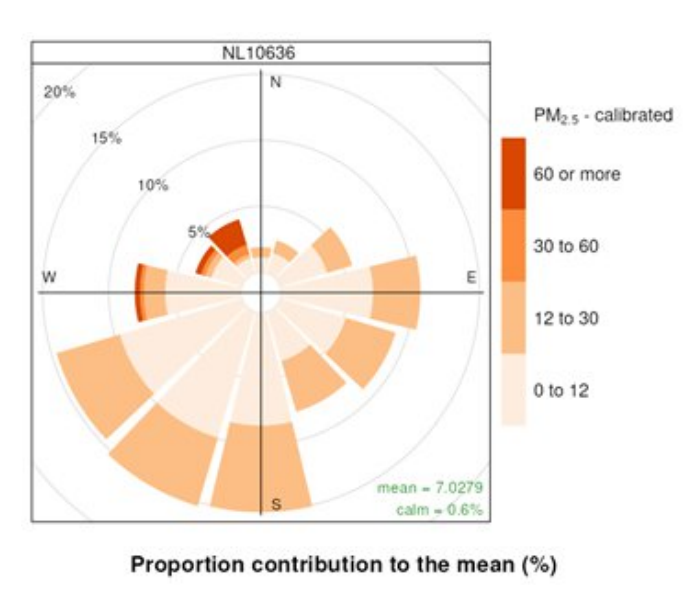

$\huge\color{#7ae4e4}{\text{Challenge 2: Discover Pollution Hotspots}}$

## Challenge Description

Hollandse Luchten collects large amounts of sensor data on air quality. Residents often question the source of pollution they experience. Organizations such as the RIVM and GGD often use wind roses to detect these local sources. 

A wind rose shows the direction, speed and frequency of the wind captured at that sensor location. By combining wind and air pollution data you can create a pollution rose. 
The plot displayed shows a weighted concentration rose. It shows, for each wind direction, the share (in %) of that direction in the overall average particulate matter concentration. The average concentration for each wind direction is weighted by how often that wind direction occurs. When making a wind rose, using different choices for timesteps, such as daily, weekly or for example very specific time periods will have a big impact on the resulting pollution rose. It is also possible to plot multiple wind roses from different locations together to obtain an even clearer picture of where hotspots may be located.
Your challenge is to create a system that automatically analyses sequences of pollution roses over time to detect unusual hotspots and support source identification.

## Problem Statement

Pollution roses are powerful tools for understanding local air quality patterns in relation to wind direction and speed. By visualizing these roses over extended time periods on a geographic map, you essentially create a "video" or time-series of frames showing how pollution patterns evolve.
Therefore, in this challenge you will focus on:
1.	Using data science and AI techniques to automatically detect unusual patterns and potential pollution hotspots in sequences of pollution roses.
2.	Developing a scoring metric that indicates how strong and unusual a hotspot is, and how certain the system is about the result.
3.	Locating identified hotspots geographically and relating them to likely wind directions and possible source areas.
4.	Communicating the results to residents in a clear and transparent manner, including why a location or direction is identified as a potential hotspot.
5.	Bonus: indicating which additional data, analyses or follow-up actions are needed to confirm a potential pollution source.

## Possible techniques

Teams may use statistical, machine-learning, deep learning and/or hybrid methods. For example, computer-vision techniques can be used to recognize spatial patterns in pollution roses, while unsupervised learning can help identify unusual patterns or deviations from normal conditions. Temporal analysis can be used to assess how pollution patterns develop over consecutive time periods.
A simple and well-validated approach may be more valuable than a complex model that is difficult to explain or verify. We expect teams to substantiate their technical choices and considerations using validation metrics, research or other evidence.

## Which data is available?

During the hackathon we will supply you with several datasets for this challenge:
·	Time-series data: hourly PM2.5 measurements from more than 100 Hollandse Luchten sensors, some ranging several years.
·	Reference measurements: Official reference station data producing hourly measurements, to possibly compare the Hollandse Luchten sensors with.
·	Metadata on sensors: information about the sensor location, type, measurement communities, and intended reference stations.
·	Weather data from the Dutch KNMI, for example temperature and humidity.
·	Some example pollution roses

## Deliverables

Your submission should at least contain:
1)	The Github repository with any used code and/or examples.
2)	The presentation of your solution.
Every team is expected to present their solution to our jury.

## Jury criteria

| Criterion | What the jury looks for |
|---|---|
| 1. Relevance to the challenge | To what extent does the solution address a concrete problem from the chosen challenge? The team explains who the solution is intended for and why it is relevant to Hollandse Luchten. |
| 2. Technical quality and reliability | The solution is logically designed and demonstrably works. The team justifies its chosen method, algorithm, or model: why is this choice appropriate for the task and the available data? The team also explains its trade-offs, for example through references to literature, comparisons with alternatives, or its own validation and reliability measurements using data-science methods. Assumptions, uncertainties, and limitations are made clear. |
| 3. Value for residents | The solution helps residents better understand, analyse, or use air-quality data. The jury considers clarity, accessibility, and practical value: what can residents do or learn with it? |
| 4. Innovation and smart application | The solution takes an original or surprising approach. Innovation may lie in the technical solution, the combination of data sources, how results are presented, or how residents are supported. The approach must remain appropriate and practical. |
| 5. Feasibility and presentation | The team clearly demonstrates how the solution works and what is needed to develop it further. The jury considers whether the demonstration or explanation is convincing, whether next steps are realistic, and whether practical requirements such as data availability, maintenance, privacy, and real-world use have been considered. The jury assesses the extent to which the solution is feasible to implement and aligns with the existing technical, social, and organisational structures of Hollandse Luchten. |

## Use of tools and generative AI
AI (coding) assistants and vibe coding are allowed, as long as teams disclose clearly on where they did and did not use them. We encourage the use of such tools, but also address that teams should be able to explain and validate important parts of their solutions themselves.  

## Metadata
The sensors of hollandse luchten will inculde the following:
date
location
sensortype
pm2.5 or pm10
calibrated or raw.

The parquet file contains the following columns: `station`, the name of the station or sensor; `date`, the date and time in the Europe/Amsterdam time zone when the hour ends; `wd`, the wind direction (missing data: -999; calm: 0; variable: 990); `ws`, wind speed in m/s; `pm10`, PM10 concentration in μg/m³; `pm10_kal`, calibrated PM10 concentration in μg/m³; `pm25`, PM2.5 concentration in μg/m³; `pm25_kal`, calibrated PM2.5 concentration in μg/m³; `lat`, the location’s latitude; and `lon`, the location’s longitude. Unavailable values are marked as `NA`.

## Resources

## Tips / links

- Start by visualizing a single time-series of pollution roses to understand the data
- Experiment with different temporal granularities to find the optimal balance
- Use clustering algorithms as a baseline before moving to neural networks
- Compare detected hotspots against known pollution events (if available)
- Consider combining spatial (CNN) and temporal (RNN) components
- Create clear visualizations showing "normal" vs. "anomalous" patterns
- Test whether your system can identify known pollution sources

## copyright
---

[Back to main README](../README.md)